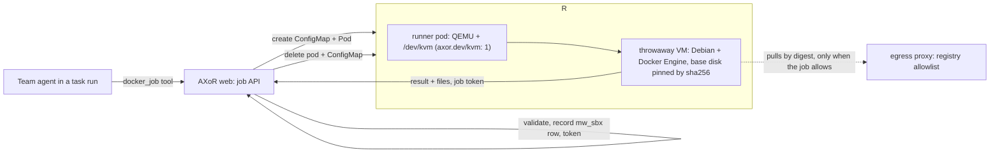

# D-013 design: the isolated VM Docker runner (G5-4 V4.1)

**Status: Approved by the Owner on 2026-11-13 (D-8), with D8-a…D8-h as recommended, for V4.2 development only.** Creating the
namespace, the RoleBinding or the image on the production cluster, and deploying, still need the Owner's written authorization.
What V4.2 built, and where it differs from this design, is in `ARCHITECTURAL_DECISIONS.md` D-013.

The text below is the design as approved. It was a design only: no manifest, image or code changes in V4.1.
- **V4.2** (the runner) starts only after you approve the topology (§2) and the interfaces (§3–§5), with your answers to §8.
- **V4.5** (the SN61 checklist) follows V4.2.

Base: D-013 (requirements and constraints, `ARCHITECTURAL_DECISIONS.md`); the 2026-11-11 KVM test; `machines.py`,
`k8s/base/55-machines.yaml`, `sandbox.py`, `egress_proxy.py`, `k8s/base/56-sandbox.yaml`, `57-egress.yaml`.

## 1. What it is for

D-013's requirements, and where this design meets each one:

| Requirement (D-013) | Met by |
|---|---|
| Controlled agent job submission | One agent tool, `docker_job`. Every job is validated by AXoR before any VM starts (§3). |
| Restricted execution permissions | Docker runs as root inside a throwaway VM, never on the host. The pod is unprivileged with `/dev/kvm` only (§2). |
| Docker image build and push | Job kinds `build` / `run` / `bench`. `push` is a separate kind that runs only with a person's approval (§5). |
| Image digest verification | Pulls only by `@sha256:`. Built images are recorded by digest. A push names the digest it pushes (§4). |
| Mock and live benchmarks | Job kind `bench`. The live one needs a secret and the network, so it needs a person's approval (§5). |
| RAM and container health measurements | The runner samples `docker stats` and `docker inspect` health and records peak memory and health (§4). |
| Logs and reproducible artifacts | Logs and files return to the team's files under `runs/sbx-<id>/`, with the environment record (§4). |
| Human approval for external submissions | `push`, live `bench` and anything that reaches a chain or registry are approval-bound (§5). |
| Constraint: no host Docker socket, no host root | Nothing mounts the socket. Pod Security baseline. No service-account token in the pod (§2). |

## 2. Topology

**One VM per job (recommended).** It boots from a read-only base disk with a copy-on-write overlay in the pod's `emptyDir`, runs
the job, reports and is deleted. No state survives a job. The 11-11 test (boot, build, `compose up`, fetch, stats) took 105 s, so
a job costs about a minute and a half of start-up. That is the price of a clean environment per job. A long-lived runner VM is the
alternative in §8 (D8-a).

**The pod.** It looks like a Machines pod (`machines.py`, image `qemux/qemu:7.50`):
- `resources.limits: axor.dev/kvm: 1`, CPU and memory a little above the VM's own;
- no privileges, no added capabilities, `automountServiceAccountToken: false`, Pod Security baseline;
- the base disk comes from a read-only volume.

**Namespace: a correction to the plan.**
- **The plan says** "a VM runner in `axor-machines`" (`G5_3_4_5_DEPENDENCY_PLAN.md` §3).
- **The problem:** that namespace's NetworkPolicy `workloads` selects every pod (`podSelector: {}`). It lets them reach the
  internet (all but private ranges) and every other pod in the namespace. NetworkPolicies only add permissions, so a runner pod
  there can't be held to less.
- **The fix I propose:** a namespace of its own, `axor-runner`, with:
  - its own `ResourceQuota` (`requests.axor.dev/kvm`: the runner's share; see D8-e);
  - a `LimitRange`;
  - a default-deny NetworkPolicy that allows cluster DNS, AXoR's result endpoint, and (only for pods labelled
    `axor.dev/internet=on`) the egress proxy.
- **Alternative (D8-g):** stay in `axor-machines` and narrow `workloads` to `podSelector: {matchExpressions: [axor.dev/runner
  DoesNotExist]}`. That changes the Machines policy, which I don't recommend.

**Rights AXoR's web account would need (V4.2):**
- `create` / `delete` on pods and configmaps in `axor-runner`;
- `get` on its resourcequota (the readiness probe).
- Today it has pod `delete` and configmap rights in `axor-machines` (`axor-operate`, `axor-platform`), but not pod `create`. A new
  RoleBinding is your approval (§8).

## 3. Interface 1: the job (what an agent may ask for)

A new agent tool, `docker_job`, next to `sandbox_run` (`mining_work.py`). AXoR validates the request, then starts the VM.

| Field | Meaning | Rule |
|---|---|---|
| `kind` | `build`, `run` or `bench` (`push` only through §5) | — |
| `paths` | Workspace files sent into the VM, as `sandbox_run` does | Same packing limits as the sandbox |
| `dockerfile` | Path of the Dockerfile in those files | Every `FROM` must name `@sha256:`, or the job is refused before it starts |
| `images` | Images to pull | `name@sha256:<64 hex>` only. A tag alone is refused. |
| `compose` | Optional Compose file | Same image rule. Published ports bind inside the VM only. |
| `command` | What runs after the build (`run`/`bench`) | A time limit applies (`timeout_s` ≤ the cap) |
| `memory_mb`, `cpus` | The VM's size | Capped by the runner's limits |
| `network` | `none` (default) or `registry` (pulls through the egress proxy) | `registry` reaches only the registry allowlist (§8 D8-c) |
| `secrets` | Names of secrets the job needs (for example `BEX_CHALLENGE_API_KEY`) | Never values from the agent. A named secret makes the job need approval (§5). |

**Record:** one `mw_sbx` row per job (kind recorded as `services = 'vm-docker'`, the pod name in `pod`), the same table every
sandbox run uses. No schema change. Consequences:
- **V4.4's `evidence_ref` (`sbx:<id>`) points at a runner job unchanged.** A benchmark filed in a run whose newest clean job was a
  runner job rests on that job.
- The budget, the day cap and the board's run views already read `mw_sbx`.

## 4. Interface 2: what comes back

The VM runs one fixed runner script (sha256 pinned in the base disk). It returns this, through the job's own token, to AXoR:

| Field | Content |
|---|---|
| `status`, `exit` | `done` (exit 0), `failed`, `timeout`, `error`, as sandbox runs |
| `output` | The log tail (the full log saved as a file) |
| `images` | For every image built or pulled: tag, `Id`, `RepoDigests`. A pulled image whose digest differs from the one asked is a failure. |
| `stats` | Peak memory and CPU per container (`docker stats` sampled every 2 s), OOM kills, restarts |
| `health` | Per container: `docker inspect` health status, plus the job's own health URL if it gives one |
| `environment` | Base disk sha256, runner script sha256, Docker and Compose versions, kernel, VM size, start and end times |
| `inputs` | sha256 of the files sent and of the job spec |
| `files` | Artifacts the job names (for example `bench_out/live.json`), saved into the team's files under `runs/sbx-<id>/` |

**What it guarantees:**
- **V4.3:** a person freezing a release can take the image digest from a job's `images`, because it is the built image's
  content address.
- **V4.5:** each checklist item's artifact is tied to commit, digest, environment and time, through `inputs`, `images` and
  `environment`.

## 5. Interface 3: approvals (external effects)

These job kinds need a person's approval:
- a job that names a secret;
- a job with `network: registry` whose target is a push;
- `push`;
- a live benchmark against a third party's endpoint.

**Mechanism:** the existing G5-2 approval (`POST /api/g5/risks/{id}/approve`). It's admin only, hash-bound (mission, task, action,
payload sha), single use and consumed at start, with a 24 h expiry. The payload hash covers the job spec and, for `push`, the
exact image digest. An approved push pushes that digest and nothing else. Without approval the job is recorded as held, never
started. Registration and submission on a chain stay outside the runner: they are the Owner's actions (D-014, V4.5).

## 6. Readiness (the V4.2 acceptance criterion)

**Today:** `mission_ops._docker` always answers FAIL ("No Docker runner is connected").

**After V4.2:** PASS only when both hold:
- the runner is configured (namespace, quota with KVM > 0, the base disk present);
- a real job completed: an `mw_sbx` row with `services = 'vm-docker'`, `status = 'done'`, exit 0, in the last 7 days, whose
  `environment` names the current base disk.

Otherwise it answers UNKNOWN, with the reason. `_registry` stays FAIL until an approved push has completed once. `_vm` reads the
runner's quota instead of the sandbox's.

## 7. What changes, and how it's undone

| Change (V4.2) | Kind | Undo |
|---|---|---|
| Namespace `axor-runner`: quota, LimitRange, default-deny NetworkPolicy, RoleBinding for `web` | Manifest (your approval) | Scale to zero / delete the namespace |
| Base disk: a pinned Debian cloud image with Docker Engine, built by a script in `k8s/`, kept in a read-only volume, sha256 recorded | Build step | Delete the volume |
| `docker_job` tool, job API, result endpoint on the existing sandbox proxy port | Code | Previous image; the tool disappears |
| Probes `_docker`, `_registry`, `_vm` | Code | Previous image |

**Tests:**
- **Unit:** job validation, digest rules, approval binding, result parsing, the probe.
- **Integration:** one real job on a staging VM, before any production use (`TEST_AND_STAGING_PLAN.md` V4.2–V4.5).

## 8. Your decisions (D-8)

| # | Question | Recommendation |
|---|---|---|
| D8-a | One VM per job, or a long-lived runner VM | One per job: no state carries between jobs; about 1.5 min start-up |
| D8-b | Job records in `mw_sbx` (no schema change) or a new table | `mw_sbx`; V4.4's `evidence_ref` works unchanged |
| D8-c | Network for pulls | Through the egress proxy, with a registry allowlist (Docker Hub, GHCR). Egress-proxy routing from a VM is still unproven (D-013 evidence), so it's the first integration test. |
| D8-d | Push credentials | Injected only into an approved `push` job, which pushes one digest; never in other jobs |
| D8-e | How many KVM devices the runner may use (the node offers 8, shared with Machines) | 2 |
| D8-f | Base disk | Built once by a script, pinned by sha256, stored read-only; never downloaded at boot |
| D8-g | Namespace: `axor-runner` (new) or `axor-machines` with its policy narrowed | `axor-runner`; it changes nothing for Machines |
| D8-h | The RoleBinding for `web` in the runner namespace (pods, configmaps create/delete; resourcequotas get) | Approve with V4.2 |
